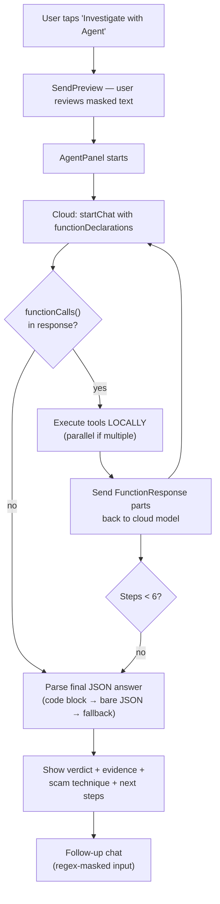
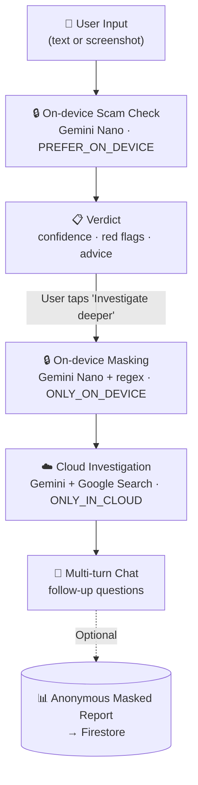

# ScamShield

**Spot scam messages instantly — privately, offline-first, powered by Gemini Nano in your browser.**

[](LICENSE)
[](https://firebase.google.com/docs/ai-logic)
[](https://devpost.com/software/)

---

## The Problem

Scam messages are a daily reality across Nigeria and similar regions:

- **Fake bank alerts** — "Your Zenova Bank account has been debited ₦50,000…"
- **BVN/NIN phishing** — "Provide your BVN to avoid account suspension"
- **Job scams** — "You have been shortlisted. Pay ₦5,000 for registration"
- **Fake transfer alerts** — Fabricated screenshots used to defraud vendors

People need a quick way to check suspicious messages, but:
1. Uploading private messages to random servers exposes sensitive personal data.
2. Connectivity is unreliable and data is expensive in many regions.
3. Most existing scam checkers are web-only, slow, and privacy-invasive.

---

## The Solution

ScamShield is a **private, offline-first scam checker** that runs directly in Chrome using
[Firebase AI Logic hybrid inference](https://firebase.google.com/docs/ai-logic/hybrid-inference).

- **On-device first**: Gemini Nano analyses your message locally — no data leaves the device.
- **Personal details never leave the device**: Names, phone numbers, account numbers, and
  BVN/NIN are masked on-device before anything can go to the cloud.
- **Deep investigation when you need it**: Optionally tap "Investigate deeper" to let the cloud
  model search the web for corroborating evidence — using only the already-masked text.

---

## How Hybrid Inference Works in ScamShield

ScamShield uses a **Rules + AI** hybrid architecture designed for the limited capabilities of Gemini Nano (a small on-device model):

1. **Rule engine runs first** (`src/ai/rules.js`) — pure JS, no network. Detects 10 signal types (links, credential requests, urgency, etc.) and 3 safe cues (do-not-share warnings, masked account numbers, standard alert structure). Returns `{ signals, ruleScore }`.
2. **Signals injected into prompt** — the AI sees what patterns the rule engine already found, so it focuses on reasoning rather than pattern-matching from scratch.
3. **AI outputs in reasoning-first order** — schema enforces `redFlags → explanation → verdict → confidence → category` so Gemini Nano must cite evidence before committing to a verdict.
4. **Evidence check** — any AI-flagged phrase that doesn't appear in the actual message is dropped (hallucination prevention).
5. **Verdict consistency overrides** — deterministic post-processing catches contradictions (e.g. "scam" with zero evidence → downgraded to "suspicious").
6. **Second opinion** — when the result is "suspicious" or low-confidence, the user can opt in to a cloud check; personal details are masked before leaving the device.

| Step | Where | Inference Mode | Privacy guarantee |
|------|-------|---------------|-------------------|
| Rule engine | On-device (pure JS) | — | No network at all |
| Scam check — on-device | Gemini Nano | `ONLY_ON_DEVICE` | Raw text stays on device |
| Entity detection (masking step 2) | Gemini Nano | `ONLY_ON_DEVICE` | Names, addresses, DOB detected locally |
| PII masking | On-device (regex + AI) | `ONLY_ON_DEVICE` | Placeholder map **never** leaves device |
| Scam check — cloud (Nano unavailable) | Cloud (Gemini) | `ONLY_IN_CLOUD` | SendPreview gate: user reviews masked text |
| Agent investigation | Cloud | `ONLY_IN_CLOUD` + tools | Masked text only; tools execute locally |
| Agent tools | On-device (pure JS / Firestore) | — | Never leave the device |
| Devices without Gemini Nano | Cloud (consent-gated) | `ONLY_IN_CLOUD` | SendPreview masking gate; informed degradation |

---

## ScamShield Agent

After the initial on-device check, the user can tap **"Investigate with ScamShield Agent"** to run a deeper cloud-based investigation. The agent uses Firebase AI Logic function calling to coordinate a set of tools, most of which run **locally on the device** — only the reasoning step runs in the cloud.

### Tools

| Tool | Runs where | What it does |
|------|-----------|-------------|
| `analyze_link` | On-device (pure JS) | Detects phishing signals in a URL — IP hosts, punycode, URL shorteners, risky TLDs, excessive subdomains, brand impersonation, Levenshtein lookalikes. No network request. |
| `check_community_reports` | On-device → Firestore | Queries the anonymous community reports database for a domain or phone number. Returns count, last report date, and top scam categories. Uses deterministic mock data until Firestore is deployed. |
| `search_web` | Cloud (`ONLY_IN_CLOUD` + Google Search) | Makes a **separate** grounded call (function declarations and Google Search cannot be combined in a single Gemini request). Returns a 60-word summary and sources. Sources displayed with shadow DOM per Google TOS. |
| `get_scam_trends` | On-device → Firebase Remote Config | Fetches the latest `scam_trends` string from Remote Config. Falls back to a built-in default if unavailable. |

### How the agent loop works



### Human-in-the-loop design

- The user **reviews and approves** the masked text before anything is sent (SendPreview gate).
- **Only the reasoning step** is in the cloud — `analyze_link` and `check_community_reports` are pure local functions that never make network requests beyond the user's own Firestore.
- The placeholder→original map is kept only in browser memory and is never transmitted.
- Follow-up messages are regex-masked automatically before sending.
- Tool results are **data fed to the model** — the system prompt instructs the model never to follow instructions found in tool results or in the message text.

---

## Architecture



---

## Firebase Products

| Product | Purpose | Status |
|---|---|---|
| **Firebase AI Logic** | Hybrid inference — Gemini Nano (on-device) + Gemini (cloud) | ✅ Done |
| **App Check** | reCAPTCHA Enterprise; debug token for localhost | ✅ Done |
| **Firestore** | Anonymous masked community reports | 🚧 In progress |
| **Anonymous Auth** | User identity for Firestore writes without sign-in | 🚧 In progress |
| **Remote Config** | `scam_trends` string injected into prompts for up-to-date signals | 🚧 In progress |
| **Firebase Hosting** | Production deployment | 🚧 In progress |

---

## Features

- ✅ Firebase AI Logic hybrid inference wired up (on-device + cloud)
- ✅ On-device inference with Gemini Nano (ONLY_ON_DEVICE model)
- ✅ Cloud inference (ONLY_IN_CLOUD model, Gemini Developer API)
- ✅ App Check with reCAPTCHA Enterprise (dev debug token support)
- ✅ **Rules + AI hybrid** — rule engine provides grounded signals; AI reasons about them; evidence check prevents hallucinated red flags
- ✅ **Scam check feature** — structured JSON output (verdict, confidence, category, redFlags with phrase+reason, explanation)
- ✅ **Explicit hybrid routing** — on-device → download prompt → cloud (SendPreview-gated); no silent fallbacks
- ✅ **On-device PII masking** — 2-step: regex detects numbers/emails/URLs; Gemini Nano detects names, addresses, DOBs. Placeholder map stays on device.
- ✅ **SendPreview** — user reviews detected entities as chips before any cloud call; can toggle each entity between masked/kept. `onSend(maskedText)` only receives the masked string.
- ✅ **ScamShield Agent** — function-calling agent loop: `analyze_link` (local heuristics), `check_community_reports` (Firestore + mock), `search_web` (separate grounded call, since Google Search + function declarations cannot combine in one request), `get_scam_trends` (Remote Config). Max 6 tool-call steps. Final answer as structured JSON with evidence, technique, next steps.
- ✅ **AgentPanel** — live step timeline showing each tool call + result + duration; final verdict card with evidence tagged by source; follow-up chat with auto regex masking
- ✅ **Redesigned UI (session 9)** — chat-bubble interface (plum brand, Bricolage Grotesque + Atkinson Hyperlegible), TopBar with ≡ menu, pinned Composer, animated verdict bubble, PrivacyPage, AboutPage, restyled Dashboard, new Logo SVG (bubble→shield shape)
- ✅ **Full production UI** — ModelStatus (friendly single line), MessageInput (composer with clipboard paste), VerdictCard (verdict bubble with checklist), SendPreview ("Before we search online" sheet), AgentPanel (typing bubbles)
- ✅ **Developer test harness** — 20 synthetic test messages, FP/FN tracking, markdown/JSON export, 4 inference modes (AI-only / Rules+AI / Cloud / Hybrid)
- ✅ **In-app accuracy dashboard** (`#/accuracy`) — comparison chart, per-message table, live run
- 🚧 Screenshot / image input (OCR via Gemini Nano)
- 🚧 Firestore community reports
- 🚧 Remote Config scam trend injection

---

## Tech Stack

- **Frontend**: React 19 + Vite 8
- **AI**: Firebase AI Logic (hybrid), Gemini Nano (Chrome built-in), Gemini (cloud)
- **Backend**: Firebase (App Check, Firestore, Auth, Remote Config)
- **SDK**: Firebase JS SDK v12 (modular, tree-shakeable)
- **Language**: JavaScript (ES modules)

---

## Requirements for On-Device AI (Gemini Nano)

The on-device path requires:

| Requirement | Minimum |
|---|---|
| Browser | Chrome 139+ on Windows, macOS, or Linux (desktop only) |
| Free disk space | 22 GB |
| GPU VRAM | > 4 GB |
| Or, without a GPU | 16 GB RAM + 4 CPU cores |
| Network | Unmetered connection for the initial model download (~1.5 GB) |

> The app **falls back gracefully** when Gemini Nano is unavailable — the scam check routes to
> the cloud model, and the user is informed before anything is sent.

---

## Getting Started

### Prerequisites

- Node.js 18+
- Chrome 139+ (for on-device testing)
- A Firebase project (see steps below)

### 1. Clone and install

```bash
git clone https://github.com/abdulhameedabdullahi/Scamshield.git
cd Scamshield
npm install
```

### 2. Create a Firebase project

1. Go to [console.firebase.google.com](https://console.firebase.google.com) and create a project.
2. Add a **web app** to the project. The config object (apiKey, projectId, etc.) is already
   committed in `src/firebase.js` for the submission project.

### 3. Enable Firebase AI Logic

1. In the Firebase console, go to **Build → AI Logic**.
2. Follow the wizard to enable the **Gemini Developer API** backend.
3. This links the AI Logic service to your Gemini API key automatically.

### 4. Set up App Check (reCAPTCHA Enterprise)

1. Go to [Google Cloud Console → reCAPTCHA Enterprise](https://console.cloud.google.com/security/recaptcha).
2. Create a key: **web key**, add `localhost` as an allowed domain.
3. Copy the **site key** (the public key — starts with something like `6L…`).
4. In the Firebase console, go to **App Check → Apps → Register** and choose
   **reCAPTCHA Enterprise**. Paste the site key there.

### 5. Set up Google Safe Browsing (optional)

The `analyze_link` agent tool can query the **Google Safe Browsing v4 Lookup API** to flag
confirmed malicious URLs. It is optional — if the key is absent the tool falls back to
local heuristics only.

1. Go to [Google Cloud Console → APIs & Services → Credentials](https://console.cloud.google.com/apis/credentials).
2. Click **Create credentials → API key**.
3. Click **Edit key** (pencil icon) to restrict it:
   - **Application restrictions**: HTTP referrers → add your production domain (e.g. `https://scamshield.web.app/*`) and `http://localhost:5173/*` for local dev.
   - **API restrictions**: Restrict to → select **Safe Browsing API** only.
4. Copy the key.

### 6. Configure environment variables

```bash
cp .env.example .env.local
```

Edit `.env.local`:

```env
VITE_RECAPTCHA_SITE_KEY=your-recaptcha-enterprise-site-key-here
VITE_FIREBASE_APPCHECK_DEBUG_TOKEN=   # leave blank for now — see step 7
VITE_SAFE_BROWSING_API_KEY=your-safe-browsing-api-key-here   # optional
```

### 6. Start the dev server

```bash
npm run dev
```

Open [http://localhost:5173](http://localhost:5173) in Chrome 139+.

### 7. Register the App Check debug token

On first run with a blank `VITE_FIREBASE_APPCHECK_DEBUG_TOKEN`, the Firebase SDK
will print a debug token in the browser console:

```
[Firebase] App Check debug token: xxxxxxxx-xxxx-xxxx-xxxx-xxxxxxxxxxxx
```

1. Copy that UUID.
2. In the Firebase console, go to **App Check → Apps → your web app → Manage debug tokens**.
3. Click **Add** and paste the UUID.
4. Paste it into `.env.local` as `VITE_FIREBASE_APPCHECK_DEBUG_TOKEN=<uuid>`.
5. Restart the dev server (`Ctrl+C` then `npm run dev`). The token is now stable.

> You can also use the Firebase CLI:
> ```bash
> firebase appcheck:debugtokens:create --app <your-app-id>
> ```

### 8. Verify on-device AI availability

Open DevTools console and run:

```js
await LanguageModel.availability()
// Expected: "available" or "downloadable"
```

If it returns `"downloadable"`, click the **"Test on-device"** button in the app. Chrome will
start downloading Gemini Nano (~1.5 GB) in the background. You can monitor the progress in
`chrome://components` → **Optimization Guide On Device Model**.

---

## Testing Instructions for Judges

🚧 **Live demo link coming soon** — the app is currently in active development
(submission deadline: Nov 30, 2026).

To test locally, follow the Getting Started steps above and use the **Dev Test Panel**
in the app to verify that:

1. On-device inference returns a response from Gemini Nano
2. Cloud inference returns a response from the Gemini cloud model
3. The on-device availability badge shows the correct status for your device

---

## Project Structure

```
scamshield/
├── src/
│   ├── firebase.js          Firebase app, App Check, AI service (exports app + ai)
│   ├── config.js            App constants (CLOUD_MODEL, APP_NAME)
│   ├── ai/
│   │   ├── models.js        On-device and cloud model instances
│   │   ├── availability.js  On-device availability helpers (wraps LanguageModel API)
│   │   ├── prompts.js       Prompt templates 🚧
│   │   ├── schemas.js       Response schema definitions 🚧
│   │   ├── checkMessage.js  Scam check logic (PREFER_ON_DEVICE) 🚧
│   │   ├── maskMessage.js   PII masking — always on-device, never cloud 🚧
│   │   └── investigate.js   Cloud investigation + chat (ONLY_IN_CLOUD) 🚧
│   ├── services/
│   │   └── reports.js       Firestore community reports 🚧
│   ├── components/
│   │   └── DevTestPanel.jsx Dev/test UI: availability status + inference buttons
│   ├── App.jsx              Root component
│   ├── main.jsx             Vite entry point
│   └── index.css            Global styles
├── .env.example             Environment variable template (safe to commit)
├── .gitignore
├── LICENSE                  Apache-2.0
├── package.json
└── vite.config.js
```

---

## Built During #BuildHybridAI

Everything in this repo (except the Vite React scaffold) was written during the
**Firebase #BuildHybridAI hackathon submission period (Nov 11–30, 2026)**.

The only pre-existing code is the [official Vite React template](https://github.com/vitejs/vite/tree/main/packages/create-vite/template-react)
(`vite.config.js`, `index.html`, `main.jsx`, `eslint.config.js`). All other files
were created for this submission.

---

## Privacy and Security

- **On-device first**: scam checks run locally by default — no message text is sent anywhere.
- **Masking policy**: before any cloud call, personal details are replaced with numbered placeholders on-device.
  - **Masked by default**: names, addresses, dates of birth, account numbers, BVN/NIN, OTP codes, card numbers, emails.
  - **Kept as evidence**: phone numbers and URLs (needed to check if they appear in known scam databases). Labelled "evidence" in SendPreview.
  - The placeholder→original map is kept only in browser memory and is never sent, stored, or logged.
- **User in control**: `SendPreview` shows every detected entity as a chip before any cloud call. The user can tap to toggle any item between masked and kept.
- **maskMessage.js uses `ONLY_ON_DEVICE`**: the on-device AI masking step will throw rather than fall back to cloud. If Nano is unavailable, regex masking is used and the UI notes "basic masking only".
- **App Check**: every Firebase API call is validated with reCAPTCHA Enterprise.
- **No secrets in the repo**: `.env.local` is gitignored; the reCAPTCHA secret key and debug tokens are never committed.
- **Anonymous reports**: Firestore reports contain only masked text and AI verdicts.

---

## Limitations & Roadmap

### Current Limitations

- **On-device AI requires desktop Chrome 139+** — Gemini Nano (the in-browser AI model) only runs on desktop Chrome 139 or newer with 22 GB free disk space and a compatible GPU or 16 GB RAM. It is not available on mobile phones, tablets, or other browsers.
- **Phones use rules + cloud** — On phones and other unsupported devices, the rule engine runs instantly on-device (private, offline), and the AI check uses the cloud path. The app shows a masking preview so you can review exactly what will be sent before it goes.

### Roadmap

- Android app via Firebase AI Logic hybrid inference with Gemini Nano, when Android support ships
- Chrome extension (passive background scanning of incoming messages)
- Pidgin, Hausa, and Yoruba language support (cloud path)
- More scam categories: investment scams, romance scams, lottery scams

---

## License

Apache-2.0 © 2026 Abdulhamid Abdullahi Sulaiman

See [LICENSE](LICENSE) for the full text.

---

## Acknowledgements

- [Firebase AI Logic](https://firebase.google.com/docs/ai-logic) — hybrid inference SDK
- [Gemini Nano in Chrome](https://developer.chrome.com/docs/ai/built-in) — on-device language model
- [Chrome Prompt API](https://developer.chrome.com/docs/ai/prompt-api) — browser-native AI session
